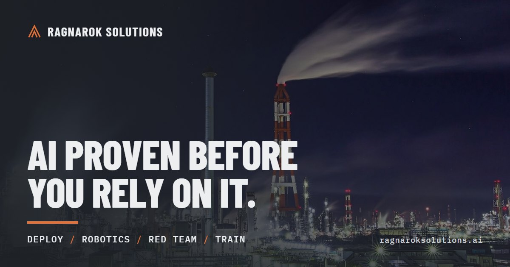

<a href="https://ragnaroksolutions.ai"></a>

# Ragnarok Solutions

**Your AI gave you a number. Would you sign it?**

We make AI work you can put your name under. We find where it is wrong, we build the tests that train it, and we install it in your own building, proven first in a copy of a business like yours. Every figure names the record behind it.

**Deploy · Test robots · Red team · Train**  ·  [ragnaroksolutions.ai](https://ragnaroksolutions.ai)  ·  Michigan, USA

---

### Research

**Visual Reasoning Failure Modes Protocol: construction and measurement of figure-based probes designed to separate careful human reading from vision-language model reading**
DeFlumeri, N. Ragnarok Solutions LLC. Version 1.0 (first edition, draft for comment), 15 October 2026. Technical note, 267 pp. CC BY 4.0.
Nineteen ways vision-language models misread figures, documents and imagery. Each comes with a computed trap answer, a trap-free twin, a text-only control and a human fairness floor.

[](https://doi.org/10.5281/zenodo.23384044)

```
DeFlumeri, N. (2026). Visual Reasoning Failure Modes Protocol: construction and measurement of figure-based probes designed to separate careful human reading from vision-language model reading (Version 1.0). Zenodo. https://doi.org/10.5281/zenodo.23384044
```

Author: [ORCID 0009-0007-6489-5578](https://orcid.org/0009-0007-6489-5578) · [OSF](https://osf.io/cuhrb/)

---

### Open source

| Project | What it does | Status |
|---|---|---|
| **Tieout** | Checks any deliverable against the data it came from. Every number is traced to a source cell or recomputed, and every finding is cited. Plain Python, no model inside. | In development |

---

### How we work

- **Every figure names its record.** A finding cites the rule, the record and the check.
- **Proven before it ships.** We test on synthetic companies with defects planted on purpose. A tool has to find them there first.
- **Honest status.** Hypotheses are labelled as hypotheses. Error rates are measured and published.

[Request a pilot](https://ragnaroksolutions.ai/request-a-pilot/) · [Red teaming](https://ragnaroksolutions.ai/red-team/) · [Training environments](https://ragnaroksolutions.ai/train/)
